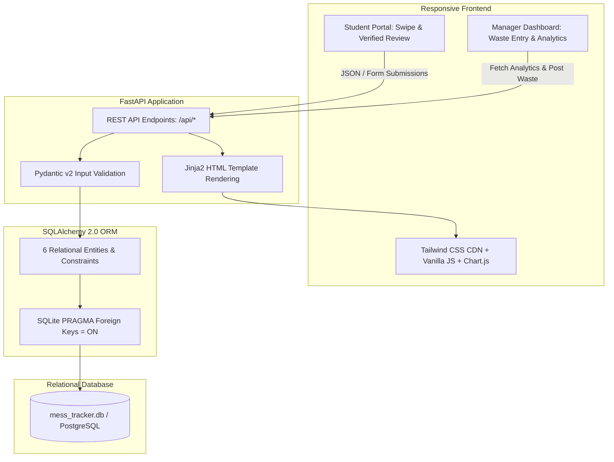
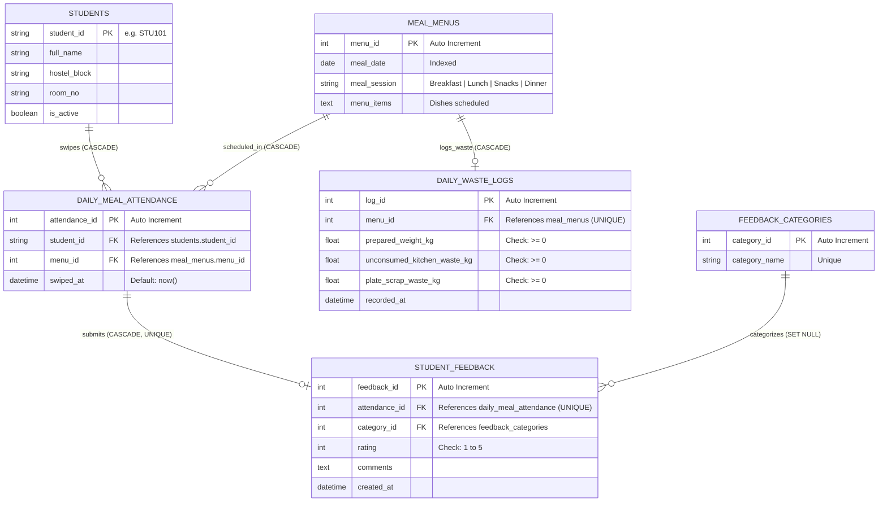

# Smart Mess Food Feedback & Waste Analytics Tracker

[](https://fastapi.tiangolo.com)
[](https://www.sqlalchemy.org)
[](https://tailwindcss.com)
[](https://www.chartjs.org)
[](LICENSE)
[](https://mess-food-waste-tracker.onrender.com)

> 🚀 **Live Demo:** [https://mess-food-waste-tracker.onrender.com](https://mess-food-waste-tracker.onrender.com)  
> 📖 **API Docs:** [https://mess-food-waste-tracker.onrender.com/docs](https://mess-food-waste-tracker.onrender.com/docs)

A production-ready college mini-project bridging student dining satisfaction with kitchen operational efficiency. The system pairs **NFC/RFID meal card swipe verification** with **authenticated student feedback** and **daily kitchen & plate waste logging** to give mess managers actionable, data-backed insights to reduce food wastage.

---

## 🌟 Key Features

### 1. Student Dining Portal
- **Daily Menu Schedule**: Displays real-time breakfast, lunch, snacks, and dinner dishes.
- **Meal Check-in / Swipe Simulation**: Simulates a physical card swipe before entering the dining hall; prevents double-swiping for the same meal session.
- **Verified Feedback Form**: Strictly unlocked **only after checking in** for that meal session; enforces a rating from 1 to 5 stars, standardized category tags (e.g. *Too Salty*, *Undercooked*, *Great Taste*), and specific comments.
- **One-Review Constraint**: Guarantees exactly one feedback entry per student attendance swipe.

### 2. Mess Manager & Analytics Dashboard
- **Executive KPI Cards**: Real-time summary of total dining swipes, overall average rating, cumulative food prepared vs. wasted (kg and %), and most frequent complaint.
- **Daily Food Waste Logger**: Easy interface for kitchen supervisors to record prepared food weight, kitchen leftovers, and plate scrapings. Features **real-time math validation** ensuring:
  $$\text{Prepared Weight} \ge \text{Kitchen Leftovers} + \text{Plate Scrapings}$$
- **Waste % vs. Average Rating Correlation Chart**: Dual-axis visualization (Chart.js) demonstrating that poor student ratings directly correlate with spikes in plate discard waste (up to 40% waste on low-rated meals).
- **Reported Issues Breakdown**: Interactive doughnut chart breaking down feedback categories to identify systemic kitchen issues (e.g. over-salting, uncalibrated frying temperatures).
- **Lowest-Rated Meals Ranking**: Data-driven backlog highlighting bottom-performing recipes paired with automated kitchen recommendations (e.g. adjust seasoning, increase boiling time, reduce batch size).

### 3. Realistic 7-Day Seed Dataset
- Pre-loaded with **15 students** across different hostels and room numbers.
- **28 scheduled meals** (Breakfast, Lunch, Snacks, Dinner across 7 days).
- **100+ attendance swipe entries** and authentic feedback reviews.
- **Correlated waste logs** illustrating high waste on poorly rated meals and low waste (<7%) on popular meals.

---

## 🏗️ System Architecture



---

## 🗄️ Relational Database Schema

The database design adheres to 3NF with cascading referential integrity and check constraints across 6 core tables:



### Constraints & Integrity Rules
1. **Swipe Uniqueness**: `UNIQUE(student_id, menu_id)` on `daily_meal_attendance` prevents duplicate check-ins for the same meal session.
2. **Review Integrity**: `UNIQUE(attendance_id)` on `student_feedback` guarantees that each physical attendance swipe can yield at most one review.
3. **Rating Range**: `CHECK(rating >= 1 AND rating <= 5)` prevents invalid scores.
4. **Waste Conservation Check**:
   $$\text{prepared\_weight\_kg} \ge (\text{unconsumed\_kitchen\_waste\_kg} + \text{plate\_scrap\_waste\_kg})$$
5. **Cascading Deletes**: When a student or menu entry is removed, associated attendance records, feedback, and waste logs cascade automatically.

---

## 🚀 Quick Start Guide

### Prerequisites
- Python 3.10 or higher installed.
- Git installed.

### Option A: One-Click Launch (Windows)
Double-click `run.bat` in the root folder. It will:
1. Install Python dependencies from `requirements.txt`.
2. Automatically create database tables and seed realistic demo data.
3. Start the FastAPI server on `http://127.0.0.1:8000`.

---

### Option B: Manual Setup (Terminal / PowerShell / Bash)

1. **Clone or Navigate to the Repository**:
   ```bash
   cd c:\Users\Anshika\Desktop\rdbms-project
   ```

2. **Create and Activate a Virtual Environment** (Optional but Recommended):
   ```bash
   # Windows
   python -m venv venv
   .\venv\Scripts\activate

   # Linux / macOS
   python3 -m venv venv
   source venv/bin/activate
   ```

3. **Install Dependencies**:
   ```bash
   pip install -r requirements.txt
   ```

4. **Seed the Database**:
   ```bash
   python seed_data.py
   ```

5. **Start the FastAPI Application**:
   ```bash
   python main.py
   # Or using uvicorn directly:
   uvicorn app.main:app --reload --host 127.0.0.1 --port 8000
   ```


## 📡 API Reference Overview

| Method | Endpoint | Description |
|---|---|---|
| `GET` | `/api/students` | List all active registered students |
| `GET` | `/api/today-menu` | Fetch today's meal schedule with student swipe verification status |
| `POST` | `/api/attendance/swipe` | Record meal check-in swipe (rejects duplicates) |
| `GET` | `/api/feedback/categories` | Retrieve standardized feedback category tags |
| `POST` | `/api/feedback` | Submit verified student feedback (requires `attendance_id`) |
| `POST` | `/api/waste` | Create or update daily kitchen & plate waste log |
| `GET` | `/api/analytics/metrics` | Fetch executive KPI card statistics |
| `GET` | `/api/analytics/waste-vs-rating`| Data series for waste % vs. average rating correlation |
| `GET` | `/api/analytics/top-issues` | Category breakdown for complaint distribution chart |
| `GET` | `/api/analytics/lowest-rated-meals` | Ranked lowest-rated meals with corrective advice |

---

## 🛠️ Pushing to GitHub

To push this repository to GitHub as `mess-food-waste-tracker`:

### Option A: Using the Automated Script
Run the automated script in your terminal:
```cmd
setup_and_push.bat
```
or in PowerShell:
```powershell
.\setup_and_push.ps1
```

### Option B: Using Git & GitHub CLI Commands
```bash
# 1. Initialize local Git repository on main branch
git init -b main

# 2. Stage all files
git add .

# 3. Commit files
git commit -m "feat: initial release of Smart Mess Food Feedback and Waste Tracker"

# 4. Set remote and push:
git remote add origin https://github.com/anshhika-shukla/mess-food-waste-tracker.git
git branch -M main
git push -u origin main
```


## 📄 License
This project is licensed under the MIT License.
